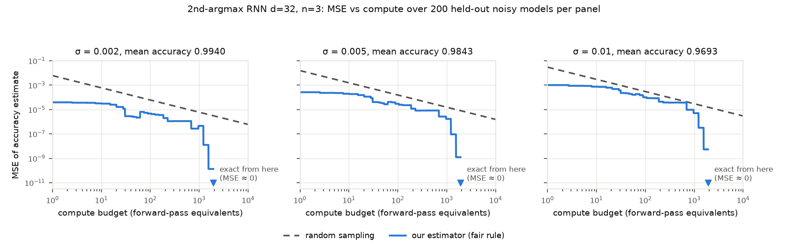
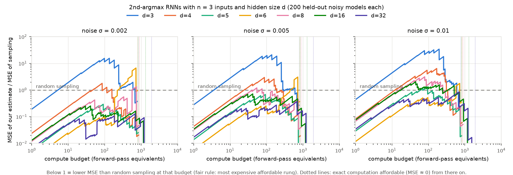

# Mechanistic accuracy estimates for AlgZoo RNNs that match random sampling

## The open problem

The [AlgZoo blog post](https://www.alignment.org/blog/algzoo-uninterpreted-models-with-fewer-than-1-500-parameters)
asks for **mechanistic estimates** of the accuracy of the zoo models: estimates that reason
deductively from the weights rather than from sampled inputs, and that are competitive with
random sampling in **mean squared error versus compute**. The evaluation protocol it suggests is
to add enough noise to the weights to change accuracy significantly, and to average the squared
error over the noisy models.

ARC reports mechanistic estimates for two 2nd-argmax models. The 10-parameter `M_{2,2}` is
fully explained and estimated with "a handful of computational operations". For the 32-parameter
`M_{4,3}`, its estimates "roughly match the computational efficiency of sampling". ARC describes
32 parameters as the largest model it more-or-less fully understands. The headline challenge,
the 432-parameter `M_{16,10}` (`example_2nd_argmax()`, a different checkpoint from
`zoo_2nd_argmax(16, 10)`), is still open (see [Limitations](#limitations)).

## Results

1. **Matching sampling on 3-input models up to 1,152 parameters, on held-out models.** For the
   1,152-parameter `M_{32,3}` (`zoo_2nd_argmax(32, 3)`), a fixed ladder of deterministic
   mechanistic estimators has **lower MSE than random sampling at every compute budget**, on 200
   fresh noisy models per noise level. The compute accounting, if anything, favours sampling. At
   σ = 0.002 and σ = 0.005 the worst-case MSE ratios to sampling are 0.13 and 0.37, with 90%
   bootstrap intervals far below 1. At σ = 0.01 the ratio is 0.86. Its interval is also below 1,
   but marginally: the one-sided bootstrap p ≈ 0.02 is not adjusted for the 21 cells tested, and
   a single extra model with about 2.2 times the largest error observed at the binding rung
   would push it above 1. The same holds, robustly, for the 320-parameter `M_{16,3}` at the two
   lower noise levels (0.25 and 0.72). It also holds for the 45-parameter `M_{5,3}` (0.29 and
   0.68), but `M_{5,3}` was not part of development, so that is a post-hoc observation from the
   test table. Six cells survive a Holm correction over all 21 at level 0.05 (their bootstrap
   p-values are below 1/2000): `M_{32,3}`, `M_{16,3}` and `M_{5,3}` at σ = 0.002 and 0.005. Note
   that ARC's `M_{4,3}` also has 3 inputs, and the cost of our method depends mainly on the
   number of inputs rather than on the number of parameters. From about 0.8–1.9 × 10³ forward
   passes, depending on the model, the estimate is exact (MSE ≈ 0). Argmedian with `n = 3` is
   the same task, and the zoo's argmedian `n = 3` models have identical weights.
2. **Exact accuracies, no sampling.** The same machinery computes the exact accuracy of all 37
   distinct AlgZoo RNN classifiers (2nd argmax and argmedian) with at most 5 inputs, up to the
   1,216-parameter `M_{32,5}` and `AM_{32,5}`. Run time grows with the number of linear regions:
   `M_{32,5}` has 24 million leaf regions, cut into 310 million simplicial cones, and took 36
   minutes on 9 processes (the root cones are independent). The answers are numerically
   converged. For the 4- and 5-input models checked (all `n = 4`, and `n = 5` with `d <= 5`),
   recomputing every Gaussian measure at higher order changes them by at most about 10⁻¹¹. For
   2- and 3-input models the measures are closed-form arcsines, accurate to about 10⁻⁹;
   cancellation on very thin cones costs a little, as an independent well-conditioned
   implementation showed. All 37 agree with 1.7 × 10⁷-sample Monte Carlo runs (|z| ≤ 2.4). The
   four largest 5-input models also agree root cone by root cone: with 6.7 × 10⁷ fresh samples,
   the χ² tests over their 240 root cones give p = 0.07–0.92. Matching even 10⁻⁹ precision by
   sampling would take 10¹³–10¹⁷ samples, depending on the model's accuracy.
3. **A mechanistic explanation of the residual error: the tie-sliver law.** The errors of
   well-trained models are thin wedges along tie hyperplanes. A first-order formula built from
   the logit gap on the tie hyperplane reproduces their error rate. For all eight `n = 2`
   models, where it reduces to ARC's `M_{2,2}` explanation, it matches the exact error to within
   1.3 × 10⁻⁶ relative (3 × 10⁻¹¹ absolute). It is within 13% for every tested model (`n <= 4`)
   with `d >= 6` and accuracy above 98%. For smaller or weaker models, whose errors are not
   dominated by slivers, it is off by −76% to +96% (up to a factor of about 4).

What is **not** solved: ARC's headline challenge `M_{16,10}`; matching sampling at intermediate
budgets for 4- and 5-input models, where exact computation costs 10⁵–10⁹ forward passes; and,
among the 3-input models, the others (`M_{3,3}`, `M_{4,3}`, `M_{6,3}`, `M_{8,3}`) and the
heaviest noise level for `M_{5,3}` and `M_{16,3}`. See [Limitations](#limitations).

### 1. MSE versus compute (3-input models, held-out noisy-weights test)





Worst-case ratio of our MSE to sampling's MSE over all budgets `B >= 1`, under the fair rule
(at each budget, the most expensive affordable rung of the fixed ladder; it never looks at the
truth). There are 200 held-out noisy models per row. The 90% interval is a percentile bootstrap
over noisy models. "Bootstrap share > 1" is the fraction of bootstrap replicates whose worst
ratio exceeds 1, a one-sided bootstrap p-value that is not adjusted for the 21 cells. **Bold**
means the whole interval is below 1. The binding rung is where the worst ratio occurs: the
ratio peaks just before that budget, when the next rung becomes affordable. The near-chance
`M_{2,3}` (accuracy 0.41) is not included.

<!-- SWEEP_TABLE -->
| model | params | σ | noisy models | mean accuracy | exact cost (fwd) | worst fair ratio | 90% CI | bootstrap share > 1 | binding rung (at budget) |
|---|---|---|---|---|---|---|---|---|---|
| `M_{3,3}` | 21 | 0.002 | 200 | 0.8458 | 790 | 15.54 | [14.92, 16.29] | 1.00 | roots4 (135) |
| `M_{3,3}` | 21 | 0.005 | 200 | 0.7979 | 783 | 20.99 | [19.78, 22.21] | 1.00 | roots4 (140) |
| `M_{3,3}` | 21 | 0.01 | 200 | 0.7191 | 767 | 34.27 | [31.57, 36.96] | 1.00 | roots6 (197) |
| `M_{4,3}` | 32 | 0.002 | 200 | 0.9776 | 862 | 1.78 | [1.73, 1.84] | 1.00 | roots4 (86) |
| `M_{4,3}` | 32 | 0.005 | 200 | 0.9623 | 846 | 2.97 | [2.82, 3.11] | 1.00 | roots4 (88) |
| `M_{4,3}` | 32 | 0.01 | 200 | 0.9311 | 843 | 6.43 | [5.98, 6.90] | 1.00 | roots8 (169) |
| `M_{5,3}` | 45 | 0.002 | 200 | 0.9949 | 841 | **0.29** | [0.28, 0.31] | 0.00 | roots6 (92) |
| `M_{5,3}` | 45 | 0.005 | 200 | 0.9874 | 827 | **0.68** | [0.64, 0.73] | 0.00 | roots6 (93) |
| `M_{5,3}` | 45 | 0.01 | 200 | 0.9741 | 814 | 1.32 | [1.24, 1.41] | 1.00 | roots6 (95) |
| `M_{6,3}` | 60 | 0.002 | 200 | 0.9977 | 799 | 6.70 | [5.60, 7.92] | 1.00 | any90 (725) |
| `M_{6,3}` | 60 | 0.005 | 200 | 0.9946 | 805 | 3.08 | [2.41, 3.83] | 1.00 | any90 (724) |
| `M_{6,3}` | 60 | 0.01 | 200 | 0.9892 | 805 | 1.78 | [1.38, 2.26] | 1.00 | any90 (723) |
| `M_{8,3}` | 96 | 0.002 | 200 | 0.9892 | 887 | 1.34 | [1.09, 1.61] | 0.99 | any128 (744) |
| `M_{8,3}` | 96 | 0.005 | 200 | 0.9717 | 895 | 1.21 | [1.15, 1.27] | 1.00 | roots6 (54) |
| `M_{8,3}` | 96 | 0.01 | 200 | 0.9416 | 894 | 3.14 | [2.92, 3.36] | 1.00 | roots8 (79) |
| `M_{16,3}` | 320 | 0.002 | 200 | 0.9880 | 1307 | **0.25** | [0.24, 0.27] | 0.00 | roots8 (41) |
| `M_{16,3}` | 320 | 0.005 | 200 | 0.9691 | 1295 | **0.72** | [0.68, 0.77] | 0.00 | roots8 (42) |
| `M_{16,3}` | 320 | 0.01 | 200 | 0.9347 | 1289 | 2.06 | [1.94, 2.18] | 1.00 | roots8 (45) |
| `M_{32,3}` | 1152 | 0.002 | 200 | 0.9940 | 1944 | **0.13** | [0.11, 0.15] | 0.00 | any512 (687) |
| `M_{32,3}` | 1152 | 0.005 | 200 | 0.9843 | 1923 | **0.37** | [0.33, 0.41] | 0.00 | any512 (690) |
| `M_{32,3}` | 1152 | 0.01 | 200 | 0.9693 | 1911 | **0.86** | [0.77, 0.97] | 0.02 | any512 (696) |
<!-- /SWEEP_TABLE -->

The ladder's weak point is its cheap rungs (`roots_k`, which linearise whole root cones) and,
for some of the other models, its mid-range rungs. A forward pass of `M_{3,3}`–`M_{8,3}` costs
only 70–350 flops, so the geometric overhead is relatively expensive. For `M_{3,3}` and
`M_{4,3}` the errors are not sliver-dominated (the tie-sliver law is off by −76% and −54%).
For `M_{6,3}` and `M_{8,3}`, whose errors are sliver-dominated, we do not yet understand why the
mid-range rungs fail.

### 2. Exact accuracies of ≤ 5-input models

`change at higher order` is how much the accuracy moves when every Gaussian measure is
recomputed at higher order (Plackett with 28 instead of 20 nodes per panel, cubature of degree 9
instead of 7), as a check on numerical precision. The cost is in forward-pass equivalents. The
Monte Carlo column uses 2²⁴ fresh samples; `z` is the difference in standard errors. For
`n <= 3` the measures are closed form, so the higher-order change is zero by construction.
The small models `M_{2,3}`, `M_{2,4}`, `M_{3,4}` and the 5-input models with `d <= 5` are far
from accurate and are included for completeness. `results/mc_roots.json` holds the per-root
Monte Carlo checks of the four largest models.

<!-- EXACT_TABLE -->
| model | params | exact accuracy | change at higher order | cost (fwd) | Monte Carlo (2^24) | z |
|---|---|---|---|---|---|---|
| `M_{2,2}` | 10 | 0.9999225685 | 0e+00 | 49.8 | 0.999921 | +0.77 |
| `M_{3,2}` | 18 | 0.9999735975 | 0e+00 | 45.2 | 0.999974 | -0.33 |
| `M_{4,2}` | 28 | 0.9999615632 | 0e+00 | 43.2 | 0.999961 | +0.55 |
| `M_{5,2}` | 40 | 0.9999768611 | 0e+00 | 42.1 | 0.999977 | -0.16 |
| `M_{6,2}` | 54 | 0.9999213211 | 0e+00 | 41.4 | 0.999920 | +0.65 |
| `M_{8,2}` | 88 | 0.9999777192 | 0e+00 | 40.7 | 0.999978 | -0.20 |
| `M_{16,2}` | 304 | 0.9999726792 | 0e+00 | 40 | 0.999973 | -0.02 |
| `M_{32,2}` | 1120 | 0.9999780121 | 0e+00 | 39.9 | 0.999978 | -0.31 |
| `M_{2,3}` | 12 | 0.4101712617 | 0e+00 | 328 | 0.410192 | -0.17 |
| `M_{3,3}` | 21 | 0.9083715809 | 0e+00 | 754 | 0.908343 | +0.40 |
| `M_{4,3}` | 32 | 0.9845503814 | 0e+00 | 865 | 0.984537 | +0.45 |
| `M_{5,3}` | 45 | 0.9991161910 | 0e+00 | 851 | 0.999108 | +1.09 |
| `M_{6,3}` | 60 | 0.9992213310 | 0e+00 | 774 | 0.999228 | -0.97 |
| `M_{8,3}` | 96 | 0.9994549030 | 0e+00 | 890 | 0.999454 | +0.08 |
| `M_{16,3}` | 320 | 0.9995081466 | 0e+00 | 1.34e+03 | 0.999504 | +0.70 |
| `M_{32,3}` | 1152 | 0.9995410620 | 0e+00 | 1.96e+03 | 0.999538 | +0.63 |
| `M_{2,4}` | 14 | 0.3280274101 | 6e-15 | 4.32e+05 | 0.328298 | -2.36 |
| `M_{3,4}` | 24 | 0.4332876450 | 8e-14 | 9.35e+05 | 0.433293 | -0.04 |
| `M_{4,4}` | 36 | 0.6020184118 | 1e-12 | 1.47e+06 | 0.601855 | +1.37 |
| `M_{5,4}` | 50 | 0.7456524969 | 7e-12 | 1.56e+06 | 0.745617 | +0.33 |
| `M_{6,4}` | 66 | 0.8647510736 | 5e-12 | 1.85e+06 | 0.864630 | +1.45 |
| `M_{8,4}` | 104 | 0.9874600108 | 1e-12 | 1.17e+06 | 0.987423 | +1.36 |
| `M_{16,4}` | 336 | 0.9983068360 | 6e-13 | 8.74e+05 | 0.998315 | -0.81 |
| `M_{32,4}` | 1184 | 0.9988002327 | 7e-13 | 7.46e+05 | 0.998792 | +0.97 |
| `M_{2,5}` | 16 | 0.3056348973 | 4e-14 | 1.61e+08 | 0.305603 | +0.28 |
| `M_{3,5}` | 27 | 0.3754419673 | 5e-12 | 1.55e+08 | 0.375440 | +0.01 |
| `M_{4,5}` | 40 | 0.4284504356 | 1e-11 | 2.06e+08 | 0.428510 | -0.49 |
| `M_{5,5}` | 55 | 0.5424323781 | 6e-12 | 4.29e+08 | 0.542502 | -0.57 |
| `M_{6,5}` | 72 | 0.7028572423 | not run | 7.44e+08 | 0.702825 | +0.29 |
| `M_{8,5}` | 112 | 0.8815144388 | not run | 7.09e+08 | 0.881561 | -0.59 |
| `M_{16,5}` | 352 | 0.9925277274 | not run | 8.59e+08 | 0.992489 | +1.83 |
| `M_{32,5}` | 1216 | 0.9972959155 | not run | 9.29e+08 | 0.997287 | +0.67 |
| `AM_{2,5}` | 16 | 0.2642094333 | 5e-14 | 2.99e+07 | 0.264125 | +0.78 |
| `AM_{4,5}` | 40 | 0.3939526176 | 7e-12 | 2.78e+08 | 0.393813 | +1.17 |
| `AM_{8,5}` | 112 | 0.6985511009 | not run | 5.45e+08 | 0.698462 | +0.80 |
| `AM_{16,5}` | 352 | 0.9831036499 | not run | 8.63e+08 | 0.983124 | -0.64 |
| `AM_{32,5}` | 1216 | 0.9955137455 | not run | 1.01e+09 | 0.995527 | -0.80 |
<!-- /EXACT_TABLE -->

### 3. The tie-sliver law

First-order tie-sliver estimate of the error rate (`sliver.py`) against the exact error rate of
the trained models:

<!-- SLIVER_TABLE -->
| model | exact error | tie-sliver law | relative difference |
|---|---|---|---|
| `M_{2,2}` | 7.7431e-05 | 7.7431e-05 | +2.8e-08 |
| `M_{3,2}` | 2.6402e-05 | 2.6402e-05 | +5.1e-08 |
| `M_{4,2}` | 3.8437e-05 | 3.8437e-05 | +2.1e-08 |
| `M_{5,2}` | 2.3139e-05 | 2.3139e-05 | +1.3e-06 |
| `M_{6,2}` | 7.8679e-05 | 7.8679e-05 | +3.1e-08 |
| `M_{8,2}` | 2.2281e-05 | 2.2281e-05 | +5.9e-08 |
| `M_{16,2}` | 2.7321e-05 | 2.7321e-05 | +4.1e-08 |
| `M_{32,2}` | 2.1988e-05 | 2.1988e-05 | +7.2e-08 |
| `M_{3,3}` | 9.1628e-02 | 2.1552e-02 | -76.48% |
| `M_{4,3}` | 1.5450e-02 | 7.0544e-03 | -54.34% |
| `M_{5,3}` | 8.8381e-04 | 1.7219e-03 | +94.83% |
| `M_{6,3}` | 7.7867e-04 | 7.7931e-04 | +0.08% |
| `M_{8,3}` | 5.4510e-04 | 6.1569e-04 | +12.95% |
| `M_{16,3}` | 4.9185e-04 | 4.8772e-04 | -0.84% |
| `M_{32,3}` | 4.5894e-04 | 4.7612e-04 | +3.74% |
| `M_{6,4}` | 1.3525e-01 | 2.6462e-01 | +95.66% |
| `M_{8,4}` | 1.2540e-02 | 1.4127e-02 | +12.65% |
| `M_{16,4}` | 1.6932e-03 | 1.7793e-03 | +5.09% |
| `M_{32,4}` | 1.1998e-03 | 1.3373e-03 | +11.46% |
<!-- /SLIVER_TABLE -->

## Method

All AlgZoo RNNs are one-layer ReLU RNNs **without biases**, and the classification tasks
(2nd argmax, argmedian) depend only on the **ordering** of the inputs. Everything below follows
from those two facts; nothing samples inputs.

**Cones.** With no biases the network is positively homogeneous and piecewise linear, so
whether it is correct depends only on the direction of `x`, and each of its linear regions is
a polyhedral cone. Accuracy is the Gaussian measure (equivalently, the normalised solid angle)
of the union of cones on which the argmax of the logits is the target.

**Symmetry roots.** We start from the `2 n!` simplicial cones
`{x_{p1} >= ... >= x_{pn}, ±x_0 >= 0}`. On each, the target position is fixed (it is read off
the ordering `p`), and so is the first activation pattern (every step-0 pre-activation is
`w_i x_0`). The Gaussian measure of each is known in closed form. If `r` is the rank of `x_0`,
the `+x_0` cone has measure `P(at least r of n inputs are positive) / n!`, and the `−x_0` cone
has `1/n!` minus that.

**Exact refinement.** A cone whose extreme rays all agree on the sign of a pre-activation lies
on one side of that neuron's hyperplane: the pre-activation is linear on the cone, and every
point is a nonnegative combination of the rays. Processing time steps in order, the
pre-activations at step `t` are linear on any cone that has not been split before step `t`.
Where the rays disagree, we split the cone exactly along that hyperplane. Cones are kept as
extreme rays plus facets and split incrementally (the double description method), and children
reuse the parent's cached pre-activations so only new rays are evaluated. Each leaf is a cone on
which the logits are linear, and the region where the target loses is cut out by at most
`n - 1` more hyperplanes. The root cones are independent, so they are processed in parallel
(`exact_parallel.py`); the accuracy is the sum of their contributions.

**Gaussian measures.** Leaves are triangulated (pulling triangulation) into simplicial cones.
For `n <= 3` a simplicial cone's measure is a closed-form orthant probability. For `n >= 4`
there are two methods. Narrow cones (rays within 0.3 rad) use an identity: intersecting a cone
with the hyperplane `u·y = 1` gives

    gamma_n(K) = (1 / |S^{n-1}|) ∫_{flat simplex} |y|^{-n} dA,

the integral of a smooth function over a flat simplex. Degree-7 Grundmann–Möller cubature
computes it to high relative accuracy. Wide cones use Plackett's formula, a one-dimensional
integral with a closed-form integrand, on geometrically graded Gauss–Legendre panels and with
quantities computed from cofactors so they stay well conditioned. Plackett's formula loses
absolute accuracy (≈ 10⁻⁹) on very thin cones through cancellation, so any wide cone it
measures below 10⁻⁶ is recomputed by cubature after bisection. Accuracy is
`root measure − Σ (incorrect pieces)` per root, or `Σ (correct pieces)` for roots where the
model is wrong at the central ray. Regions where the model is wholly right or wholly wrong
therefore cost no measure computation.

**The tie-sliver mechanism.** In a well-trained model, almost all error lives in thin wedges
along the **tie hyperplanes** `x_p = x_q`, at which the target switches between positions `p`
and `q`. On the tie hyperplane the two logits should be equal. The model's actual gap there,
`Δ(x)`, divided by the rate `g` at which the gap grows moving off the hyperplane, is how far its
decision boundary is displaced: it is wrong for `0 < τ < −Δ(x)/g`. To first order this gives
the *tie-sliver law*

    error ≈ Σ_ties Σ_sides Σ_{pieces K of the model on the tie hyperplane}
                φ(0)/g_K · E[−Δ_K·ζ ; ζ ∈ K, Δ_K·ζ < 0],

where `ζ` is standard Gaussian on the tie hyperplane. By Gaussian integration by parts the
expectation reduces to measures of `(n − 2)`-dimensional facets (closed form for `n <= 5`). For
`n = 2` this is exactly ARC's `M_{2,2}` explanation. There, the "yellow" linear pieces, where
`a_0 ≈ a_1`, contain the tie line `x_0 = x_1`, and the error is the thin wedge between the
decision boundary and that line.

**The anytime estimator (compute knob).** Exact refinement costs about 10³ forward-pass
equivalents for 3-input models. For smaller budgets there is a fixed ladder of cheaper rungs:

* `const` (cost 0) predicts accuracy 1, the prior that trained models are almost always right.
* `roots_k` analyses only the first `k` root cones, with no refinement, and leaves the rest at
  that prior. Unexamined cases are left at the prior rather than extrapolated from examined
  ones, in the spirit of ARC's
  ["Competing with sampling"](https://www.alignment.org/blog/competing-with-sampling/)
  discussion, where unchecked inputs get a default value instead of the average of checked ones.
* `any_k` refines cones exactly in order of decreasing angular width until `k` splits have been
  made, then finishes every remaining cone. A cone that is a single linear region is exact.
  Otherwise it is **linearised at its tie point**: each conflicting neuron takes the sign it has
  just inside the cone next to its tie face, where the cone's errors (tie slivers) live, or at
  the central ray if it has no tie face. As a guard against a linearisation that is badly wrong
  over a large cone, a cone with measure ≥ 0.01 whose tie linearisation claims more than 10% of
  it is wrong is also linearised at its central ray. If the two estimates differ by more than
  10% of the cone, the smaller one, which is closer to the prior, is used.
* `exact`.

The finishing rule was chosen on a development set of noisy models: seeds 32–95, which
include the failures found in review (see below), for `M_{16,3}` and `M_{32,3}` only. The
history, for transparency:

1. The plain tie rule (`tie`) and the always-on guard (`guard`) were tried first.
2. A guard that only fires when the tie estimate is implausible (`cguard`) and `tie` were then
   compared on the development set.
3. After seeing that comparison, `lguard` (the guard restricted to large cones) was designed to
   fix `cguard`'s failure on `M_{32,3}` at σ = 0.01.

The criterion was no catastrophic failures and all three `M_{32,3}` cells below 1. `tie` has
lower worst ratios on some cells, but fails `M_{32,3}` at σ = 0.005 because of one catastrophic
seed. `lguard` was then frozen and evaluated once on the fresh test set. Development-set worst
fair ratios (64 models per cell, seed-only noise):

<!-- DEV_TABLE -->
| model | σ | tie | cguard | lguard |
|---|---|---|---|---|
| `M_{32,3}` | 0.002 | 0.15 | 0.12 | 0.11 |
| `M_{32,3}` | 0.005 | 1.22 | 0.35 | 0.31 |
| `M_{32,3}` | 0.01 | 0.62 | 1.11 | 0.91 |
| `M_{16,3}` | 0.002 | 0.39 | 0.27 | 0.27 |
| `M_{16,3}` | 0.005 | 0.63 | 0.80 | 0.76 |
| `M_{16,3}` | 0.01 | 1.29 | 2.24 | 2.24 |
<!-- /DEV_TABLE -->

**Compute accounting.** Both sides are charged arithmetic operations: multiply-adds count as 2
flops, comparisons and reductions as 1, transcendental functions as 20. Sampling is charged one
*lean* forward pass per sample, `2d + (n − 1)(2d² + 2d) + 2·n_out·d`. This skips the product of
`W_hh` with the zero initial state, which our engine does not pay for either. Generating Gaussian
inputs and computing targets are not charged to sampling, which favours sampling. Our side is
charged for every necessary operation: pre-activations and their norms (cached per step and
shared by child cones), sign tests, splits, triangulation bookkeeping (charged at the cost
measured by tracing), cuts and Gaussian measures, root set-up, and the priority queue.

**Evaluation protocol.** ARC suggests perturbing the weights enough to change accuracy
significantly and averaging the squared error over the noisy models. We instantiate this by
adding `σ · RMS(tensor) · N(0, 1)` noise to each weight tensor, with σ ∈ {0.002, 0.005, 0.01}.
The noise is drawn from an RNG keyed by (seed, σ), so the three noise levels are independent
replications. The test set has **200 fresh noisy models per (model, σ)** (seeds 1000–1199),
untouched during development. Ground truth comes from the exact engine. The `exact` rung
therefore has zero MSE by construction, and the other rungs share code with it, so the engine
is validated independently against Monte Carlo: section 2 covers the trained models, and
`results/mc_validation.json` holds 2¹⁹ fresh samples for each of the 1,800 held-out models in
the `M_{5,3}`, `M_{16,3}` and `M_{32,3}` cells. Across the nine cells the χ² p-values are
0.05–1.00. The largest |z| among the 1,800 models (3.84) shrinks to −1.46 when that model is
re-checked with 2²⁴ samples. Sampling with `B` forward passes has MSE
`mean_k p_k (1 − p_k) / B`.

For a budget `B` the **fair rule** runs the most expensive rung of the fixed ladder that costs at
most `B` on average; it never looks at the truth. Between rung costs the ratio of its MSE to
sampling's grows with `B`, so we compute the worst ratio exactly, just below each next rung's
cost, over all `B >= 1`. We also give a 90% bootstrap interval (resampling noisy models) and the
bootstrap probability that the worst ratio exceeds 1.

## How this was checked

The first version of this write-up claimed that `M_{16,3}` and `M_{32,3}` beat sampling at
every budget, at all three noise levels, on 32 noisy models each. An adversarial review found
three real problems. It used five independent AI review agents (Claude subagents), each with a
different lens, and two skeptic agents tried to refute every finding:

1. **Asymmetric accounting.** Sampling was charged for `W_hh · h_0` with `h_0 = 0`, which the
   engine never paid for. Fixing this raised every ratio by about 1.4×, and on those 32 models
   `M_{16,3}` no longer passed at σ = 0.002 and σ = 0.01.
2. **A rare catastrophic failure.** On fresh noise seeds, one `M_{32,3}` model had a whole
   root cone mis-linearised (estimate 0.888 against a true 0.988). On those seeds (32–63) the
   worst ratio at σ = 0.005 rose to 1.66; it is 1.22 over seeds 32–95 with the final accounting
   (development table, `tie`). The large-cone guard above was added to fix this.
3. **No uncertainty.** 32 models with heavy-tailed errors cannot support an "every budget"
   claim, and the three noise levels had reused the same noise directions.

The review found no leakage of ground truth into the estimates or the rung choice. In a check
whose outputs were not saved, ground truth matched Monte Carlo on all 192 models of the
original headline settings; `results/mc_validation.json` now saves the corresponding check for
the held-out models. A second review of the final version found no further substantive
problems. Its corrections are reflected here: multiplicity, the history of the rule choice,
`n <= 3` precision, and wording. Everything above comes from the corrected accounting, the
frozen rule and the fresh test set.

## Limitations

* **`M_{16,10}` is still open.** The exact engine refines every linear region, and their number
  grows exponentially with sequence length. Sampling 200k inputs of `M_{16,10}` gives 138k
  distinct activation-pattern sequences, so exact refinement is hopeless there. Its error is
  also not tie-sliver dominated: about a fifth comes from inputs with at most one positive
  value, and a substantial part from large gaps. A cheaper understanding of the dense neurons
  is still needed.
* **Intermediate budgets for `n >= 4`.** Exact computation of 4- and 5-input models costs
  10⁵–10⁹ forward-pass equivalents. Above that budget it beats sampling by many orders of
  magnitude. Below it our approximate rungs were not competitive: in exploratory runs on
  `M_{16,4}`, not included in `results/`, they were 10–500× worse than sampling in MSE. In 4-D
  the unresolved cones are large, and linearising them is unreliable.
* **Small 3-input models and the heaviest noise.** The fair ladder loses to sampling over a
  window of budgets for `M_{3,3}`, `M_{4,3}`, `M_{6,3}` and `M_{8,3}` at every noise level, and
  for `M_{5,3}` and `M_{16,3}` at σ = 0.01 (see the table). It always wins once exact
  computation is affordable, at about 10³ forward passes. For these models a forward pass is
  cheap (70–1,200 flops), so the geometric overhead of the cheap rungs is relatively expensive.
  For `M_{3,3}` and `M_{4,3}` the errors are not sliver-dominated. For `M_{6,3}` and `M_{8,3}`
  we do not yet know why the mid-range rungs fail. ARC's own estimates for `M_{4,3}` "roughly
  match the computational efficiency of sampling"; ours do not at intermediate budgets.
* **The estimator rule was chosen on a development set.** The finishing rule was chosen among
  three candidates on development seeds 32–95, then frozen; all reported numbers come from
  fresh seeds 1000–1199. The noise model, its scale and the number of models are our own
  instantiation of ARC's qualitative suggestion. The ladder builds in the prior that trained
  models are nearly perfect (the `const` and `roots_k` rungs). Against a sampler given the same
  prior through shrinkage, the margins at the cheapest budgets would be smaller.
* **Compute is counted, not timed.** Both sides are charged arithmetic operations. Our
  Python implementation is not fast in wall-clock terms.

## Reproducing

```bash
pip install -e .            # from the repo root; plus numpy, scipy, matplotlib
cd research
python test_engine.py M2,2 M4,3 M8,4          # exact engine vs Monte Carlo
./run_tables.sh                                 # exact accuracies (n <= 5), tie-sliver law, per-root MC
./run_dev.sh                                     # development set used to choose the finishing rule
./run_test.sh                                    # held-out test: 7 models x 3 noise levels x 200 models
python summarize.py results/test/*.jsonl         # worst-case ratios with bootstrap intervals
python mc_validate.py results/test/M_{5,16,32}_3_*.jsonl  # independent Monte Carlo check of ground truth
python plot.py 32 16                             # figures
python make_tables.py --readme                   # refill the tables in this README
```

All runs are resumable (results are appended per model, and per root cone in
`results/roots/`). Files: `engine.py` (cones, refinement, exact estimator, anytime estimator
and ladder), `exact_parallel.py` (the exact estimator over root cones in a process pool),
`orthant.py` (orthant probabilities), `slice.py` (slice cubature), `sliver.py` (tie-sliver
law), `evaluate.py` (noisy-ensemble protocol), `summarize.py`, `plot.py`, `make_tables.py`,
`exact_table.py`, `sliver_table.py`, `mc_validate.py`, `mc_roots.py` (per-root Monte Carlo
check), `test_engine.py`, `test_sliver.py`.
